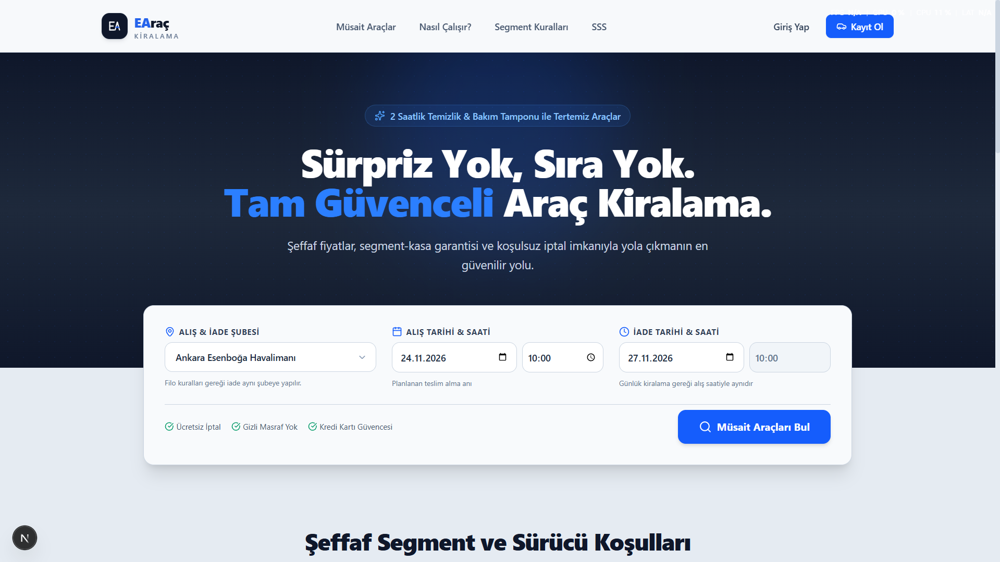
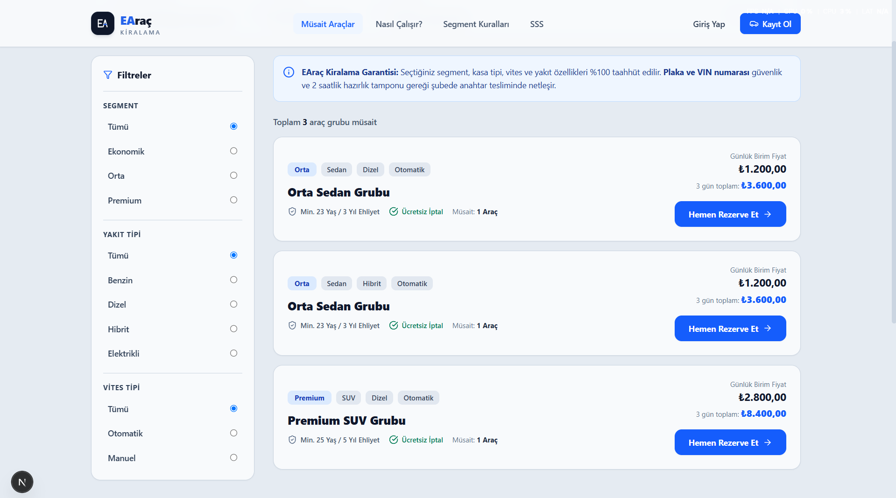
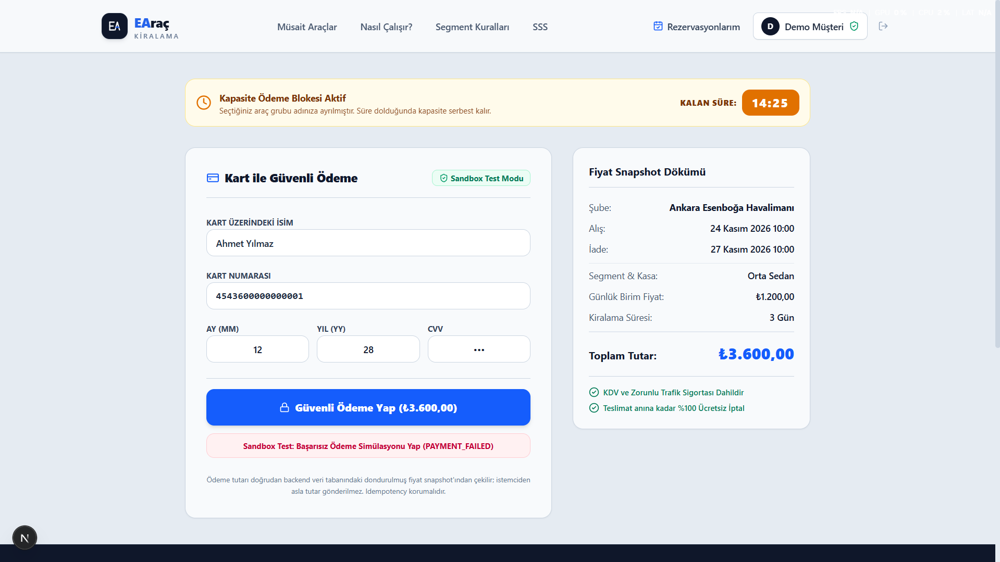
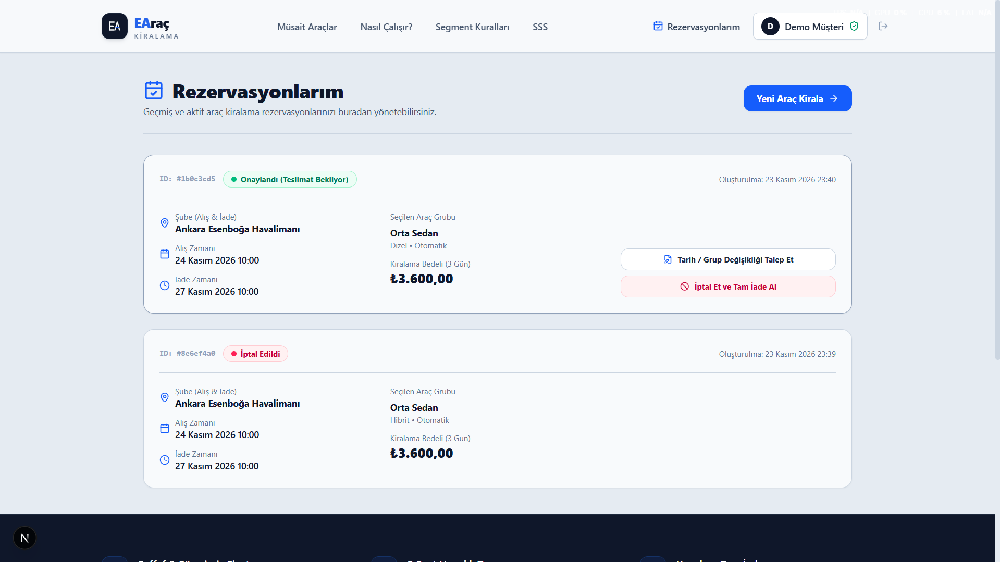
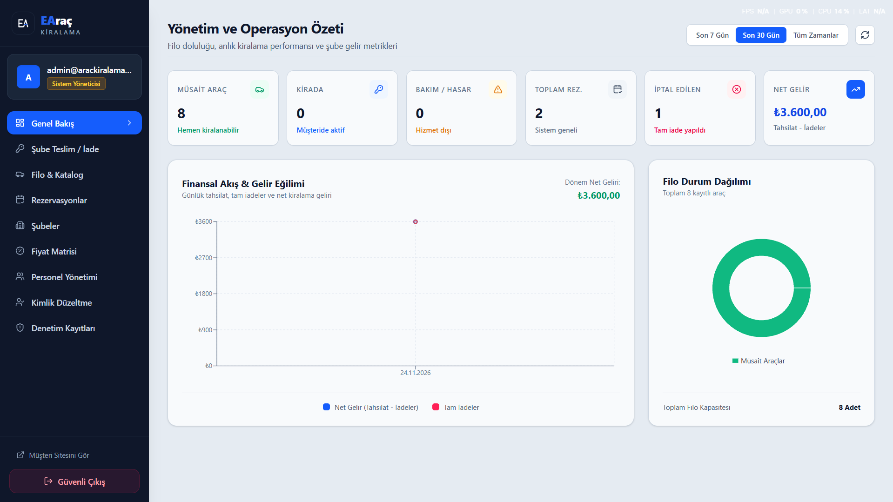
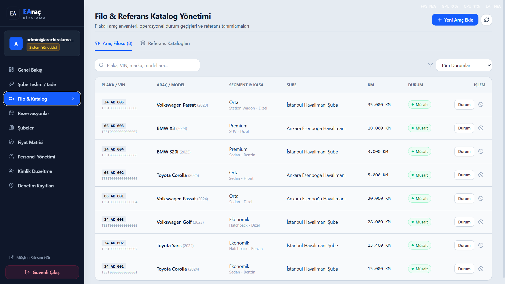

# EAraç Kiralama Platformu

EAraç Kiralama; filo operasyonları, dinamik kapasite tahsisi, şube teslimat/iade süreçleri ve çevrimiçi rezervasyon yönetimini tek bir çatı altında birleştiren kurumsal araç kiralama sistemidir. 

Sistem; veri tutarlılığı, eşzamanlı işlem güvenliği (concurrency control), yasal veri koruma standartları (KVKK/GDPR) ve kesintisiz operasyonel süreçler gözetilerek Modüler Monolit (Modular Monolith) mimarisiyle tasarlanmıştır.

---

## Ekran Görüntüleri

| Müşteri Portalı – Arama & Rezervasyon | Müşteri Portalı – Müsait Araçlar & Filtreler |
|:---:|:---:|
| <br><sub>**Ana Sayfa & Rezervasyon Arama Motoru**</sub> | <br><sub>**Müsait Araç Listesi & Segment/Kasa/Vites Filtreleri**</sub> |
| **Güvenli Ödeme & 15 Dk Kapasite Blokesi** | **Müşteri Rezervasyonlarım & İptal/İade Paneli** |
| <br><sub>**15 Dk TTL Kapasite Blokesi & Dondurulmuş Fiyat Snapshot**</sub> | <br><sub>**Rezervasyon Takibi, İade ve Değişiklik Talebi**</sub> |
| **Yönetim & Operasyon Dashboard** | **Filo & Plakalı Envanter Yönetimi** |
| <br><sub>**Operasyonel Metrikler & Finansal Gelir Grafikleri**</sub> | <br><sub>**Plakalı Araç Envanteri, Şube Atamaları & Durum Yönetimi**</sub> |

---

## Mimari Yaklaşım ve Sistem Tasarımı

Platform; domain sınırları net biçimde çizilmiş, bağımsız test edilebilir ve yatayda ölçeklenebilir katmanlı bir mimariye sahiptir.

```
                           +---------------------------------------+
                           |   Next.js 16 İstemci Katmanı (Web)    |
                           |   (App Router, Server/Client Comps)   |
                           +-------------------+-------------------+
                                               |
                                     REST API / JSON (DTO)
                                               |
                                               v
+--------------------------------------------------------------------------------------------------+
|                                  NestJS 12 Uygulama Çekirdeği                                    |
|                                                                                                  |
|  [ Auth & Identity ]  -->  [ Fleet & Vehicle ]  -->  [ Pricing Engine ]  --> [ Reservations ]   |
|  [ Handover/Return ]  -->  [ Payment Engine  ]  -->  [ Audit Logging ]  --> [ Admin/Reports  ]   |
|                                                                                                  |
|  Katmanlar: Controllers (API) -> Services (Domain Logic) -> Prisma ORM (Data Access)             |
+--------------------------------------------------------------------------------------------------+
                                               |
                                      PostgreSQL 19 DB
                        (pg_advisory_xact_lock, AES-256-GCM, HMAC)
```

### 1. Modüler Monolit ve Katmanlı Mimari
Arka uç uygulaması, mikroservislerin getirdiği dağıtık ağ karmaşıklığına ve gecikmelerine girmeden, yüksek tutarlılık ve net modül sınırları sağlayan 12 çekirdek modülden (`Auth`, `Users`, `Vehicles`, `Branches`, `Pricing`, `Reservations`, `Payments`, `Handover`, `Notification`, `Report`, `Audit`, `Health`) oluşur. İş mantığı katı kurallarla backend servisleri içerisinde izole edilmiştir; istemci tarafına iş kuralı çoğaltması yapılmaz.

### 2. Üç Katmanlı Hibrit Veri Yönetimi
Veri bütünlüğü ile işletme operasyonlarının esnekliği arasındaki denge üç katmanlı modelle sağlanır:

| Katman | Kapsam | Yönetim İlkesi |
|---|---|---|
| **1. Sabit İş Kuralları (Hard Rules)** | Asgari yaş/ehliyet sınırları (`Economic: 21/2`, `Medium: 23/3`, `Premium: 25/5`), 24 saatlik kiralama döngüsü, 2 saatlik hazırlık tamponu ve 15 dakikalık ödeme blokesi. | Kod ve konfigürasyon seviyesinde korunur. Yönetim panelinden anlık değiştirilemez. |
| **2. Dinamik İşletme Verileri (Soft Deactivation)** | Kasa tipleri, yakıt tipleri, vites türleri, marka/model hiyerarşisi, şubeler, segment-kasa fiyat matrisleri ve araç envanteri. | İlişkisel PostgreSQL tablolarında tutulur. Geçmiş işlemlerle ilişkili kayıtlar fiziksel olarak silinmez (`DELETE` kısıtlıdır); yalnızca pasife (`isActive: false`) alınır. |
| **3. Sistem Kayıtları (Immutable / Audit)** | Rezervasyonlar, fiyat anlık görüntüleri (`ReservationPriceSnapshots`), ödeme hareketleri, teslim/iade tutanakları ve denetim kayıtları (`AuditLogs`). | Sistem tarafından mühürlenir. Geçmişe dönük mutasyon veya manuel güncelleme yapılamaz. |

---

## Temel İş Kuralları ve Durum Makineleri (State Machines)

### 1. Kapasite ve Eşzamanlılık Yönetimi (Concurrency Control)
- **15 Dakikalık Ödeme Blokesi (TTL):** Müşteri ödeme ekranına geçtiğinde, seçilen araç grubu (`Şube + Segment + Kasa + Yakıt + Vites`) için 15 dakikalık geçici blokaj oluşturulur (`PENDING_PAYMENT`).
- **PostgreSQL Advisory Lock Koruması:** Eşzamanlı rezervasyon taleplerinde, şube ve tarih aralığı bazında `pg_advisory_xact_lock` çalıştırılarak veritabanı işlem seviyesinde kilit uygulanır. Böylece aynı araç grubu için çifte rezervasyon (overbooking) oluşması matematiksel olarak engellenir.
- **Lazy Check & Zaman Aşımı Temizliği:** Süresi dolan (`expiresAt <= NOW()`) rezervasyonlar sorgulama anında tembel (lazy) yaklaşımla elenir; ayrıca arka plandaki cron servisi ile otomatik uzlaştırılır.

### 2. 2 Saatlik Hazırlık Tamponu (Turnaround Buffer)
Araç iadesi ile sonraki kiralama arasında araç temizliği, teknik kontrol ve ikmal için sistemsel olarak 2 saatlik hazırlık süresi uygulanır (`TURNAROUND_BUFFER_HOURS = 2`):

$$\text{Bloke Kapasite Aralığı} = [\text{Planlanan Alış}, \text{Planlanan İade} + 2\text{ saat})$$

Aralıklar `[başlangıç, bitiş)` formatında yarı-açık değerlendirilir; önceki aracın hazırlık tamponunun bittiği dakika itibarıyla yeni kiralama başlayabilir. Araç gecikmeli dönerse, gerçek iade anından itibaren 2 saat dolmadan araç müsait sayılamaz.

### 3. Rezervasyon Durum Makinesi (8 Durum)

```
[ PENDING_PAYMENT ] ──(Ödeme Başarılı)──> [ CONFIRMED ] ──(Fiziksel Teslimat)──> [ ACTIVE ]
        │                                      │                                      │
   (Süre/Hata)                            (İptal Talebi)                         (Fiziksel İade)
        │                                      │                                      │
        v                                      v                                      v
 [ PAYMENT_FAILED / EXPIRED ]            [ CANCELLED ]                          [ COMPLETED ]
                                               │
                                      (Müşteri Gelmedi)
                                               │
                                               v
                                          [ NO_SHOW ]
```

### 4. Filo Durum Makinesi (5 Durum)

```
[ AVAILABLE ] <──(Temizlik/Kontrol)── [ MAINTENANCE ] ──(Kullanım Dışı)──> [ INACTIVE ]
      │                                       ▲
  (Teslimat)                              (Hasar Kaydı)
      │                                       │
      v                                       │
  [ RENTED ] ─────────(İade Tespiti)───────────┴───────────────> [ DAMAGED_OUT_OF_SERVICE ]
```

---

## Güvenlik Mimarisi ve KVKK Standartları

Sistem, OWASP API Security Top 10 prensipleri ve yürürlükteki kişisel veri koruma mevzuatına tam uyumlu olarak yapılandırılmıştır:

1. **Hassas Veri Koruması (AES-256-GCM & HMAC-SHA256):** T.C. Kimlik Numaraları veritabanında şifrelenmemiş (clear-text) olarak saklanmaz. Veri, AES-256-GCM algoritması ile simetrik olarak şifrelenir. Arama ve tekillik doğrulamaları ise gizli tuz (pepper) içeren HMAC-SHA256 kör indeksleme (blind index) üzerinden yürütülür.
2. **Kimlik Doğrulama ve Token Rotasyonu:** Parola güvenliğinde `argon2id` algoritması kullanılır. Oturum yönetimi; 15 dakikalık kısa ömürlü JWT Access Token ve veritabanında hash'lenmiş olarak tutulan 7 günlük `HttpOnly`, `SameSite=Lax` korumalı Cookie Refresh Token ile sağlanır.
3. **Rol Tabanlı Yetkilendirme (RBAC):** `CUSTOMER`, `STAFF` ve `SUPER_ADMIN` rolleri tanımlıdır. Personel hesapları modüler izinlerle (`RESERVATIONS`, `VEHICLES`, `HANDOVER_RETURN`, `CUSTOMERS`, `REPORTS`) sınırlandırılır; yetkisiz modül erişimleri API muhafızları (`RolesGuard`, `JwtAuthGuard`) tarafından engellenir.
4. **KYC ve Profil Kilitleme Mekanizması:** Doğrulanmış müşteri kimlik bilgileri (Ad, Soyad, TCKN, Doğum Tarihi, Ehliyet Tarihi) olası sahtecilik ve sigorta suistimalini önlemek amacıyla profil ekranında doğrudan düzenlemeye kapatılmıştır. Değişiklik talepleri gerekçesiyle birlikte resmi onay havuzuna iletilir (`IdentityCorrectionRequests`) ve yönetici denetiminden geçtikten sonra işlenir.
5. **Girdi Güvenliği ve IDOR Koruması:** Tüm API uçları `ValidationPipe` (`whitelist: true`, `forbidNonWhitelisted: true`) ile yetkisiz parametre enjeksiyonuna karşı korunur. Kullanıcılar yalnızca kendi hesaplarına ve rezervasyonlarına erişebilir.
6. **Denetim Günlüğü (Audit Logging):** Kritik operasyonlar (fiyat güncellemeleri, araç statü geçişleri, kimlik onayları, iptal/iade işlemleri) işlem yapan kullanıcı ID'si, istemci IP'si ve değişiklik ayrıntılarıyla birlikte değişmez `AuditLogs` tablosuna kaydedilir.

---

## Teknoloji Yığını

| Katman | Teknoloji / Kütüphane | Kullanım Amacı |
|---|---|---|
| **Arka Uç (Backend)** | NestJS 12, TypeScript | Modüler monolit servis mimarisi, Dependency Injection |
| **Veritabanı & ORM** | PostgreSQL 19, Prisma 7 | ACID uyumlu ilişkisel veri saklama, şema migrasyonları |
| **Ön Uç (Frontend)** | Next.js 16 (React 19), Turbopack | App Router mimarisi, SSR ve optimize istemci arayüzü |
| **Stil ve Tasarım** | Tailwind CSS v4, Lucide Icons | Responsive tasarım sistemi, kurumsal marka kimliği |
| **Grafik ve Raporlama**| Recharts | Yönetim paneli analitik ve operasyon göstergeleri |
| **Kriptografi & Güvenlik**| Argon2, Node Crypto (AES-256-GCM) | Parola hashleme, hassas veri şifreleme ve kör indeksleme |
| **Test ve Doğrulama** | Jest, Supertest, Chrome DevTools Protocol | Birim testleri, E2E testleri, canlı tarayıcı check-up'ı |

---

## Dizin Yapısı

```
earac-platform/
├── backend/
│   ├── prisma/
│   │   ├── migrations/             # Versiyonlanmış SQL migrasyon dosyaları
│   │   ├── schema.prisma           # Prisma veri modeli tanımları
│   │   └── seed.ts                 # İlk kurulum referans ve test verileri
│   ├── src/
│   │   ├── audit/                  # Sistem denetim kayıtları modülü
│   │   ├── auth/                   # JWT, Argon2 kimlik doğrulama ve SMS servisi
│   │   ├── branches/               # Şube yönetim modülü
│   │   ├── common/                 # Kripto servisleri, guard'lar, decorator ve filtreler
│   │   ├── handover/               # Şube araç teslim ve iade operasyonları
│   │   ├── health/                 # Liveness ve readiness sağlık uçları
│   │   ├── notification/           # SMS ve bildirim sağlayıcı arayüzleri
│   │   ├── payments/               # Ödeme motoru, işlem doğrulama ve simülasyon
│   │   ├── pricing/                # Segment-kasa fiyat hesaplama motoru
│   │   ├── report/                 # Yönetimsel gelir, filo ve operasyon raporları
│   │   ├── reservations/           # Kapasite kilidi, rezervasyon ve cron servisleri
│   │   ├── users/                  # Müşteri profili, personel ve kimlik düzeltme
│   │   └── vehicles/               # Envanter, marka/model ve teknik özellikler
│   ├── test/                       # E2E eşzamanlılık ve yaşam döngüsü testleri
│   └── openapi.json                # Güncel OpenAPI 3.0 sözleşmesi
├── frontend/
│   ├── src/
│   │   ├── app/
│   │   │   ├── (auth)/             # Giriş, kayıt ve şifre sıfırlama rotaları
│   │   │   ├── araclar/            # Arama, filtreleme ve araç listeleme
│   │   │   ├── hesabim/            # Müşteri profili ve KYC kilitli görünüm
│   │   │   ├── odeme/[id]/         # 15 dk geri sayımlı güvenli ödeme ekranı
│   │   │   ├── rezervasyonlarim/   # Aktif/geçmiş kiralamalar ve iptal yönetimi
│   │   │   └── yonetim/            # Filo, fiyat, teslimat, denetim yönetim paneli
│   │   ├── components/             # Yeniden kullanılabilir arayüz bileşenleri
│   │   ├── context/                # İstemci oturum ve yetki yönetimi
│   │   └── lib/                    # Tip güvenli API istemcisi ve durum haritaları
│   └── public/                     # Statik varlıklar ve ikonlar
└── docs/                           # Proje belgeleri ve ekran görüntüleri
    ├── screenshots/                # Arayüz ve yönetim paneli ekran görüntüleri
    ├── 01-project-brief.md         # Proje vizyonu ve kapsam özeti
    ├── 02-requirements.md          # Detaylı iş kuralları ve gereksinimler
    ├── 03-architecture-and-tech.md # Mimari kararlar ve teknoloji yığını
    ├── 04-data-inventory.md        # Veri envanteri ve hibrit veri modeli
    ├── 05-decisions-log.md         # Karar günlüğü
    └── 06-agent-workflow.md        # Ajan ekibi çalışma prensipleri
```

---

## Geliştirme Ortamı ve Kurulum

### Ön Koşullar
- **Node.js:** `v20.x` veya `v22.x` (LTS sürümleri önerilir)
- **PostgreSQL:** `v15` veya üzeri (Geliştirme ortamında PostgreSQL 19 kullanılmıştır)
- **Paket Yöneticisi:** `npm` (`v10+`)

### 1. Ortam Değişkenlerinin Yapılandırılması

Backend ve frontend dizinlerinde bulunan şablon dosyaları çalışma kopyası olarak çoğaltın:

```bash
# Arka uç konfigürasyonu
cp backend/.env.example backend/.env

# Ön uç konfigürasyonu
cp frontend/.env.example frontend/.env.local
```

`backend/.env` dosyası içerisinde veritabanı bağlantı adresinizi (`DATABASE_URL`) ve kriptografik anahtarlarınızı yerel ortamınıza göre tanımlayın. Yerel testlerde `PAYMENT_PROVIDER_MODE=sandbox` ve `SMS_PROVIDER_MODE=sandbox` aktif kalarak harici servis maliyeti olmadan doğrulama kodu olarak `123456` kullanılır.

### 2. Bağımlılıkların Kurulması ve Veritabanı Hazırlığı

```bash
# Backend bağımlılıkları ve veritabanı kurulumu
cd backend
npm install
npx prisma generate
npx prisma migrate dev
npm run prisma:seed
cd ..

# Frontend bağımlılıkları
cd frontend
npm install
cd ..
```

*Not: `prisma:seed` komutu; sisteme 3 ana segmenti, araç özelliklerini, 3 markayı, 6 modeli, 2 operasyonel şubeyi, 9 segment-kasa fiyat matrisini, 8 test aracını ve varsayılan süper yönetici hesabını yükler.*

### 3. Servislerin Başlatılması

Geliştirme ortamında iki ayrı terminal penceresi kullanarak servisleri ayağa kaldırın:

```bash
# 1. Terminal: Arka Uç Servisi (Port 3001)
cd backend
npm run start:dev

# 2. Terminal: Ön Uç Arayüzü (Port 3000)
cd frontend
npm run dev
```

- **Müşteri Web Portalı:** [http://localhost:3000](http://localhost:3000)
- **Yönetim & Şube Operasyon Portalı:** [http://localhost:3000/yonetim](http://localhost:3000/yonetim)
- **Swagger / OpenAPI Dokümantasyonu:** [http://localhost:3001/api/docs](http://localhost:3001/api/docs)

### Standart Süper Yönetici Giriş Bilgileri (Yerel Test)
- **Telefon Numarası:** `500 000 00 01` (Uluslararası format: `+905000000001`)
- **Parola:** `.env` dosyasındaki `SEED_ADMIN_PASSWORD` değeri (Varsayılan: `Admin123!Test`)

---

## Test Stratejisi ve Kalite Güvencesi

Sistemde regressions (gerileme) oluşmasını önlemek amacıyla çok katmanlı test otomasyonu uygulanmaktadır:

```bash
# 1. Birim Testleri (Jest - 50 Test)
# Kripto servisleri, fiyatlandırma, yetkilendirme ve domain servisleri test edilir.
cd backend
npm test

# 2. E2E Entegrasyon Testleri (Supertest - 15 Senaryo)
# Eşzamanlı çifte rezervasyon yarış durumları, yaşam döngüsü ve güvenlik senaryoları test edilir.
cd backend
npm run test:e2e

# 3. İstemci Tip Güvenliği ve Optimizasyonlu Derleme
# Turbopack motoruyla 19 rotanın derleme bütünlüğü kontrol edilir.
cd frontend
npm run build
```

---

## Lisans ve Fikri Mülkiyet
Bu proje özel mülkiyet altındadır. Kaynak kodları, tasarım varlıkları ve veri modeli izinsiz çoğaltılamaz, dağıtılamaz veya ticari amaçla kullanılamaz.
